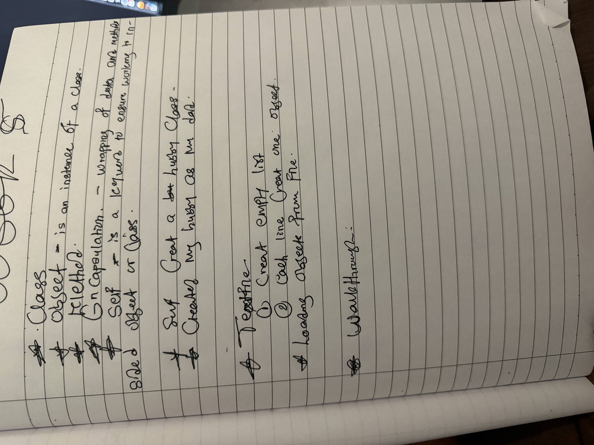

# Week 5 · Topic 2 — Methods

**Box we are building: component, that can do things**

A dict can only hold data. An object can hold data *and* the actions that belong
to it.

> **Already know this?** Skip to the *Topic 2 Challenge*.
> Worked answers added on 19 October 2026. Saved outputs are sample runs; independent understanding is checked separately.


[Open the runnable notebook](W05T02_walkthrough.ipynb)


## My Week 5 lecture notes




---
## 1. A method is a function that lives inside a class

`self` gives it access to that object's own attributes — no need to pass them in
again.

```python
class Record:
    def __init__(self, label, value, limit):
        self.label = label
        self.value = value
        self.limit = limit

    def summary(self):
        """Return a one-line description of this record."""
        return f"{self.label}: {self.value}/{self.limit}"

r = Record("R-001", 87.0, 100.0)
print(r.summary())
```

Output:

```text
R-001: 87.0/100.0
```

### Your turn
Add a method `percent(self)` to a `Record`-like class that returns `(self.value / self.limit) * 100`.

```python
class Record:
    def __init__(self, label, value, limit):
        self.label = label
        self.value = value
        self.limit = limit

    def summary(self):
        """Return the label and numbers for this record."""
        return f"{self.label}: {self.value}/{self.limit}"

    def percent(self):
        """Return the value as a percentage of the limit."""
        return (self.value / self.limit) * 100

record = Record("survey_a", 870.0, 1000.0)
print(record.percent())
```

Output:

```text
87.0
```

---
## 2. `self` is whichever object made the call

Same method, same code — `self` becomes a different object depending on who
called it.

```python
r_a = Record("R-001", 87.0, 100.0)
r_b = Record("R-002", 120.0, 100.0)

print(r_a.summary())    # self was r_a here
print(r_b.summary())     # self was r_b here, same method
```

Output:

```text
R-001: 87.0/100.0
R-002: 120.0/100.0
```

```
r_a.summary()                     r_b.summary()
     │                                  │
     ▼                                  ▼
def summary(self):                 def summary(self):
    return f"{self.label}..."          return f"{self.label}..."
     │                                  │
  self = r_a                         self = r_b
     │                                  │
     ▼                                  ▼
 "R-001: 87.0/100.0"               "R-002: 120.0/100.0"
```

### Your turn
Call the same method on two different objects and print both results side by side.

```python
print(r_a.percent(), r_b.percent())
```

Output:

```text
87.0 120.0
```

---
## 3. One method can call another, through `self`

```python
class Record2:
    def __init__(self, label, value, limit):
        self.label = label
        self.value = value
        self.limit = limit

    def percent(self):
        """Return value as a percentage of limit."""
        return (self.value / self.limit) * 100

    def status(self):
        """Return OVER LIMIT, WARNING or OK based on percent()."""
        p = self.percent()
        if p >= 100:
            return "OVER LIMIT"
        elif p >= 90:
            return "WARNING"
        else:
            return "OK"

r2 = Record2("R-002", 95.0, 100.0)
print(r2.status())
```

Output:

```text
WARNING
```

### Your turn
Add a `status()` method to your own class from Topic 1, using `self.percent()` inside it.

```python
class Server:
    def __init__(self, hostname, used, total):
        self.hostname = hostname
        self.used = used
        self.total = total

    def percent(self):
        """Return how much of the total is used, as a percentage."""
        return (self.used / self.total) * 100

    def status(self):
        """Return the status using this server's percentage."""
        percent = self.percent()
        if percent >= 100:
            return "OVER LIMIT"
        elif percent >= 90:
            return "WARNING"
        else:
            return "OK"

server = Server("srv-01", 95.0, 100.0)
print(server.status())
```

Output:

```text
WARNING
```

---
## 4. A method CAN change its own object's state

Week 3 taught you a function cannot reach outside itself and change your
variable. A method is the exception — because `self` **is** the object, not a
copy of it. This is a genuine difference, not a contradiction: the wall from
Week 3 is still there, a method just has a key to its own room.
**Clarification about state:** an ordinary function can also change an object passed to it, for example `def update(record): record.value = 95`. Reassigning a local variable is what does not reassign the caller's variable. An instance method receives the object automatically as its first argument.

```python
class Checker:
    def __init__(self):
        self.over_limit_count = 0

    def check(self, value, limit):
        """Update the running count if value is over limit."""
        if value > limit:
            self.over_limit_count += 1

c = Checker()
c.check(120, 100)
c.check(87, 100)
print(c.over_limit_count)   # 1 - it actually changed, no return needed
```

Output:

```text
1
```

### Your turn
Add a `reset(self)` method to `Checker` that sets `over_limit_count` back to `0`.

```python
class Checker:
    def __init__(self):
        self.over_limit_count = 0

    def check(self, value, limit):
        """Count this check if the value is greater than the limit."""
        if value > limit:
            self.over_limit_count += 1

    def reset(self):
        """Set this checker's count back to zero."""
        self.over_limit_count = 0

checker = Checker()
checker.check(120, 100)
checker.check(87, 100)
print(checker.over_limit_count)

checker.reset()
print(checker.over_limit_count)
```

Output:

```text
1
0
```

---
## Topic 2 Challenge

Add `percent(self)` and `status(self)` to your `Record` class from Topic 1.
`status()` should call `self.percent()`, not recalculate it. Test it on two
different instances.

```python
class Record:
    def __init__(self, label, value, limit):
        self.label = label
        self.value = value
        self.limit = limit

    def percent(self):
        """Return the value as a percentage of the limit."""
        return (self.value / self.limit) * 100

    def status(self):
        """Return the status by calling percent()."""
        percent = self.percent()
        if percent >= 100:
            return "OVER LIMIT"
        elif percent >= 90:
            return "WARNING"
        else:
            return "OK"

record_one = Record("survey_a", 870.0, 1000.0)
record_two = Record("survey_b", 1200.0, 1000.0)

print(record_one.label, record_one.percent(), record_one.status())
print(record_two.label, record_two.percent(), record_two.status())
```

Output:

```text
survey_a 87.0 OK
survey_b 120.0 OVER LIMIT
```

---
## Same idea, three fields

| Field | Looks like |
|---|---|
| **AI / Data Science** | `dataset.summary()` |
| **Cyber Security** | `alert.escalate()` |
| **IT** | `server.check_disk()` |

---
## Common mistakes

| Mistake | What you see | Fix |
|---|---|---|
| calling a method without the object — `status()` not `r.status()` | `NameError` | methods are called on an object: `r.status()` |
| recalculating instead of calling another method | works, but repeats logic | call `self.other_method()` instead of rewriting it |
| forgetting a method needs `self` even with no other parameters | `TypeError` | every method's first parameter is `self`, always |
| expecting a method's `return` to also update the caller's variable | it only returns — nothing updates unless you reassign, or the method sets `self.x` | `return` a value, or update `self` directly — know which one you meant |

## Go deeper

`examples/01_defining_methods.py` — methods, calling other methods through self
`examples/02_methods_that_change_state.py` — the one thing methods can do that Week 3's functions could not

---
## Recap

| You can now | Using |
|---|---|
| define a method | a function inside a class, first parameter `self` |
| call it | `obj.method()` |
| have one method use another | `self.other_method()` |
| change the object's own state | `self.attribute = new_value` inside a method |

**Next:** Topic 3 — many objects, working together.
